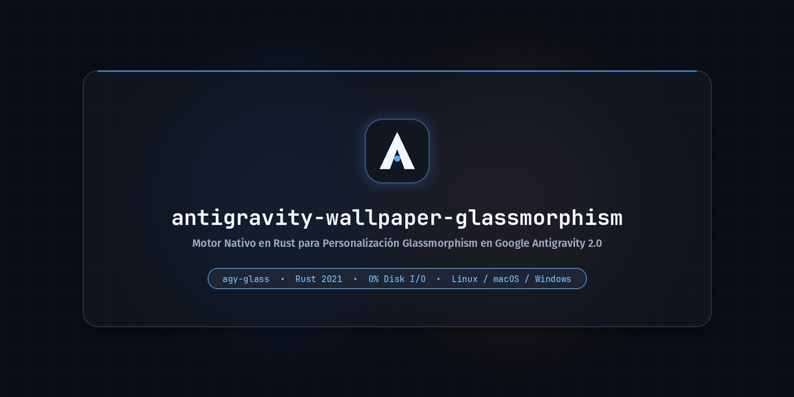
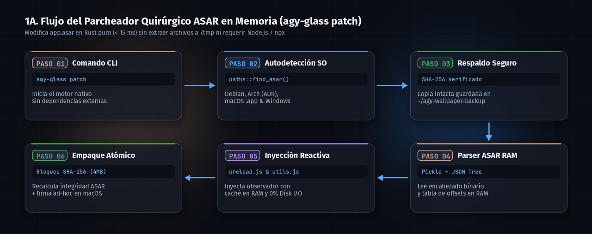
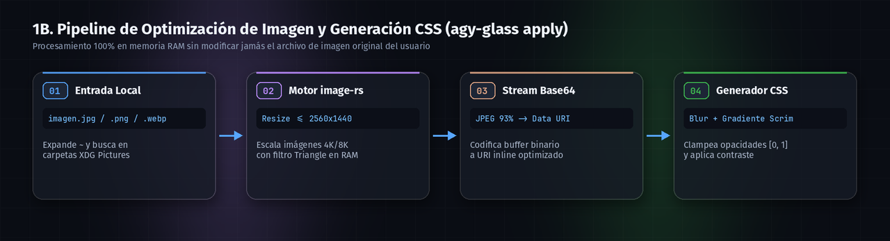
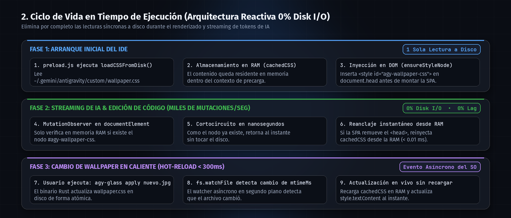
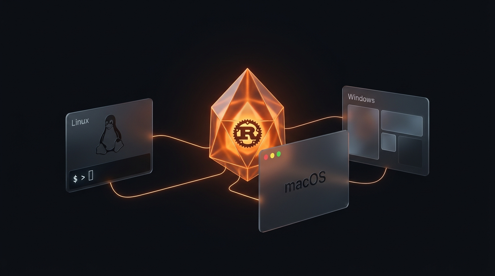
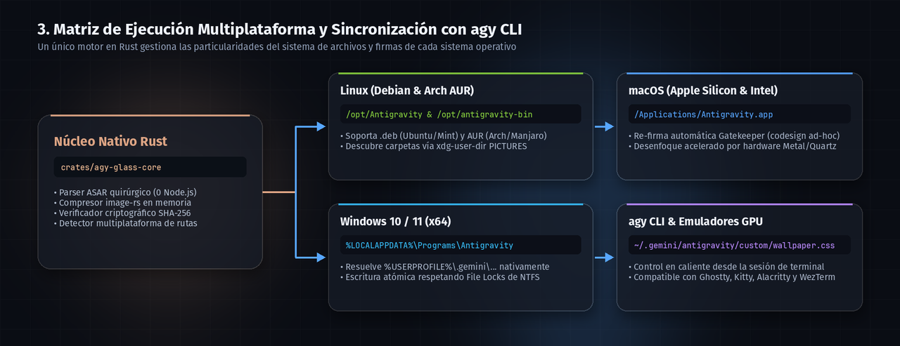

# 🌌 Antigravity Wallpaper Glassmorphism (`agy-glass`)

<div align="center">
  

  <br />

  [-DEA584.svg?logo=rust&logoColor=white)](https://www.rust-lang.org/)
  [-87cf3e.svg?logo=linux&logoColor=white)](https://archlinux.org/)
  [](https://www.apple.com/macos/)
  [-0078D6.svg?logo=windows&logoColor=white)](https://www.microsoft.com/windows)
  [](https://antigravity.google)
  [](LICENSE)
</div>

> **Motor nativo en Rust (`agy-glass`) para personalización avanzada de fondos y efecto Glassmorphism en Google Antigravity 2.0. Parcheo quirúrgico de paquetes `.asar` sin depender de Node.js/npx, caché reactiva en RAM con 0% Disk I/O durante el renderizado y soporte multiplataforma para Linux (Debian/Arch), macOS y Windows.**

<div align="center">
  
</div>

---

## ⚡ ¿Por qué `agy-glass` en Rust?

Originalmente, personalizar Antigravity requería tener instalados **Python 3.10+, pip, Pillow, websockets, Node.js, npm y `@electron/asar`**, extrayendo miles de archivos a `/tmp` y ejecutando lecturas síncronas a disco en cada mutación del DOM.

El nuevo motor **`agy-glass`** reescribe toda la arquitectura en **Rust puro**:

| Métrica / Característica | Motor Legacy (Python + npx) | Motor Nativo `agy-glass` (Rust) |
|---|---|---|
| **Dependencias Externas** | Python + Pip + Node.js + NPM + npx | **0 (Binario estático autónomo)** |
| **Manipulación de `app.asar`** | Extrae y reempaqueta +10,000 archivos en `/tmp` | **Parcheo quirúrgico en memoria (< 15 ms)** |
| **Integridad ASAR Electron** | Delegada a procesos externos | **Cálculo nativo de bloques SHA-256 (4 MB) + Pickle** |
| **Lecturas a Disco en el DOM** | `fs.readFileSync` en cada mutación + polling 800ms | **0% Disk I/O (Caché en RAM + `fs.watchFile` asíncrono)** |
| **Contraste y Accesibilidad** | Rompía estados `disabled:opacity-50` de Tailwind | **Gradiente Scrim adaptativo sin alterar estados UI** |

---

## 🏛️ Arquitectura Visual del Sistema

### 1A. Flujo del Parcheador Quirúrgico ASAR (`agy-glass patch`)

<div align="center">
  
</div>

### 1B. Pipeline de Procesamiento de Imagen en Memoria (`agy-glass apply`)

<div align="center">
  
</div>

### 2. Ciclo de Vida en Tiempo de Ejecución (0% Disk I/O en el Hilo de Renderizado)

<div align="center">
  
</div>

---

## 🌍 Ecosistema Multiplataforma (Linux, macOS, Windows & `agy CLI`)

<div align="center">
  
</div>

### 3. ¿Cómo opera el núcleo en cada entorno?

<div align="center">
  
</div>

---

## 🛠️ Guía de Instalación y Uso por Sistema Operativo

### 🐧 1. Linux (Debian, Ubuntu, Linux Mint, Arch Linux / Manjaro)

```bash
# 1. Clonar el repositorio y compilar el binario nativo en Rust
git clone https://github.com/darwinsin822/antigravity-wallpaper-glassmorphism.git
cd antigravity-wallpaper-glassmorphism
cargo build --release

# 2. Diagnosticar tu instalación (Detecta paquetes .deb, /opt y AUR antigravity-bin)
./target/release/agy-glass doctor

# 3. Parchear Antigravity IDE (Crea backup SHA-256 automáticamente)
./target/release/agy-glass patch

# 4. Aplicar un wallpaper con personalización de opacidad, blur y contraste scrim
./target/release/agy-glass apply ~/Pictures/nebula.jpg --opacity 0.65 --blur 14 --scrim 0.45

# 5. Listar wallpapers disponibles en tus directorios XDG
./target/release/agy-glass list
```

### 🍎 2. macOS (Apple Silicon M1/M2/M3/M4 & Intel — `zsh`)

En macOS, `agy-glass` detecta automáticamente el bundle `/Applications/Antigravity.app` y ejecuta `xattr -cr` + `codesign --force --deep --sign -` tras el parcheo para que **Apple Gatekeeper** permita ejecutar la aplicación modificada sin alertas:

```zsh
# Compilar e instalar en macOS
git clone https://github.com/darwinsin822/antigravity-wallpaper-glassmorphism.git
cd antigravity-wallpaper-glassmorphism
cargo build --release

# Parchear /Applications/Antigravity.app y re-firmar localmente
./target/release/agy-glass patch

# Aplicar wallpaper en vivo
./target/release/agy-glass apply ~/Pictures/macos_dark.png --opacity 0.60 --blur 16 --scrim 0.40
```

### 🪟 3. Windows 10 / 11 (`PowerShell`)

En Windows, asegúrate de **cerrar Antigravity antes de ejecutar `patch` o `restore`** (ya que Windows bloquea el archivo `app.asar` mientras el proceso está activo):

```powershell
# Compilar en Windows con Cargo
git clone https://github.com/darwinsin822/antigravity-wallpaper-glassmorphism.git
cd antigravity-wallpaper-glassmorphism
cargo build --release

# Verificar rutas en %LOCALAPPDATA%\Programs\Antigravity
.\target\release\agy-glass.exe doctor

# Parchear Antigravity (con el IDE cerrado)
.\target\release\agy-glass.exe patch

# Aplicar wallpaper (funciona con el IDE abierto en caliente)
.\target\release\agy-glass.exe apply "$env:USERPROFILE\Pictures\cyberpunk.jpg" --opacity 0.65 --blur 12 --scrim 0.45
```

---

## 🎨 Ajustes en Vivo y Restauración

### Ajustar valores manualmente en tiempo real
El archivo de estilos generado reside en `~/.gemini/antigravity/custom/wallpaper.css`:

```css
:root {
  --background: rgba(12, 14, 18, 0.65) !important;          /* Fondo del editor */
  --sidebar: rgba(14, 16, 22, 0.72) !important;             /* Barra lateral */
  --card: rgba(16, 18, 24, 0.70) !important;                /* Tarjetas y burbujas de chat */
  --agy-wallpaper-scrim: rgba(8, 10, 14, 0.45) !important;  /* Película de contraste (0.0 a 1.0) */
}
```
Al guardar cualquier cambio en ese archivo, `fs.watchFile` actualiza la ventana abierta de Antigravity en **menos de 300 ms** sin reiniciar.

### 🔄 Restauración Segura al Estado de Fábrica
```bash
# Restaura el respaldo original verificando que el hash SHA-256 sea idéntico
./target/release/agy-glass restore

# Opcional: restaurar el respaldo más reciente en lugar del de fábrica
./target/release/agy-glass restore --latest
```

---

## 📁 Estructura del Proyecto (Cargo Workspace)

```text
antigravity-wallpaper-glassmorphism/
├── Cargo.toml                  # Configuración del Workspace en Rust (Edición 2021)
├── AGENTS.md                   # Especificación de arquitectura y reglas para Agentes IA
├── README.md                   # Documentación visual y técnica
├── LICENSE                     # Licencia MIT
├── .github/workflows/ci.yml    # Pipeline CI/CD (Cargo test + AST + Verificación)
├── crates/
│   ├── agy-glass-core/         # Biblioteca núcleo en Rust:
│   │   ├── src/asar.rs         # Parser/Packer quirúrgico de archivos Electron .asar
│   │   ├── src/paths.rs        # Autodetección Debian, Arch (AUR), macOS y Windows
│   │   ├── src/image_proc.rs   # Optimización JPEG en memoria y Data URI Base64
│   │   ├── src/css_gen.rs      # Generador CSS con soporte de gradiente Scrim
│   │   ├── src/patcher.rs      # Inyección reactiva sin fugas de memoria
│   │   └── src/backup.rs       # Copias de seguridad y validación SHA-256
│   └── agy-glass-cli/          # Binario CLI (agy-glass) con clap
├── assets/                     # Banners y diagramas técnicos Glassmorphism en alta resolución
├── styles/                     # Plantillas base CSS documentadas
├── legacy/python/              # Scripts originales en Python preservados como referencia
└── docs/                       # Análisis de arquitectura SPA y Tailwind
```

---

## 📊 Evidencia de Ejecución Determinista

<div align="center">
  
</div>

---

## 👥 Maintainers & Contributors

* **DarwinSin** ([@darwinsin822](https://github.com/darwinsin822)) — Conceptualización original, diseño visual Glassmorphism & análisis del DOM.
* **Kineyo** ([@Kineyo](https://github.com/Kineyo)) — Arquitectura del motor nativo en Rust (`agy-glass`), parser quirúrgico ASAR, seguridad y soporte multiplataforma.

---

## 📄 Licencia

Este proyecto está bajo la Licencia [MIT](LICENSE).
