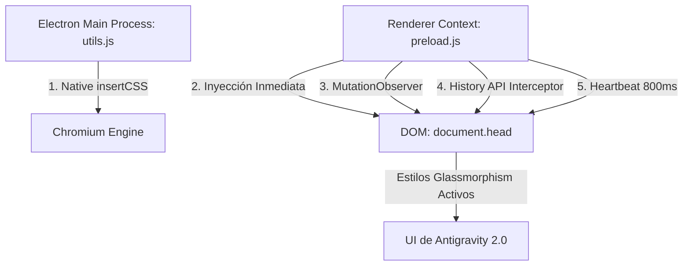

# Arquitectura del Motor de Persistencia Indestructible (Doble Blindaje)

## Introducción

Google Antigravity 2.0 (v2.9.1+) es una aplicación basada en **Electron** que encapsula una arquitectura web moderna (SPA servida localmente por un backend interno en Go / `language_server`). 

Al no ser un fork de VS Code y tener `devTools: false` en producción sin sistema de extensiones para temas, la personalización requiere una solución a nivel de runtime Electron.

## El Desafío Técnico de la SPA

Durante las pruebas iniciales observamos que los estilos inyectados mediante `did-finish-load` clásico o `insertCSS` básico desaparecían por dos razones:

1. **Hidratación y Remontaje React/Tailwind:** La SPA cubre la pantalla con `
`, aplicando `--background: #101010` (negro sólido) sobre el `body`.
2. **Reinicio de Puerto Dinámico (`language_server`):** Cuando el servidor de lenguaje interno renueva su puerto dinámico, el proceso principal de Electron ejecuta `win.loadURL(newUrl)`, destruyendo el contexto JS de la página previa.
3. **Navegación Interna (HTML5 History API):** Los cambios de proyecto, chat o explorador se realizan mediante `pushState`/`replaceState` sin recargar la ventana completa de Electron.

## La Solución: 5 Niveles de Blindaje

### 1. Nivel Preload (`preload.js`)
El script de precarga se ejecuta en cada ventana y marco con privilegios de Node.js (`fs`, `path`, `os`) antes de que el contenido web empiece a ejecutarse. Lee directamente `~/.gemini/antigravity/custom/wallpaper.css` e inserta `<style id="agy-wallpaper-css">`.

### 2. MutationObserver
Un observador continuo montado en `document.documentElement` detecta cualquier mutación del árbol DOM. Si el framework frontend remueve o altera el nodo de estilos, el observador lo reinyecta en el mismo ciclo de eventos.

### 3. Intercepción de History API
Se sobrescriben `history.pushState` y `history.replaceState`, y se escucha el evento `popstate`. Cualquier cambio de ruta SPA reasegura los estilos.

### 4. Heartbeat Periódico (800 ms)
Un intervalo liviano verifica periódicamente la integridad del nodo y detecta si el archivo en disco fue modificado por `apply_wallpaper.py`, actualizando la ventana automáticamente en menos de un segundo sin recargas de página.

### 5. Respaldo Nativo de Chromium (`utils.js`)
El proceso principal de Electron conecta `win.webContents.insertCSS()` a los eventos `did-finish-load`, `dom-ready`, `did-navigate` y `did-navigate-in-page`.
